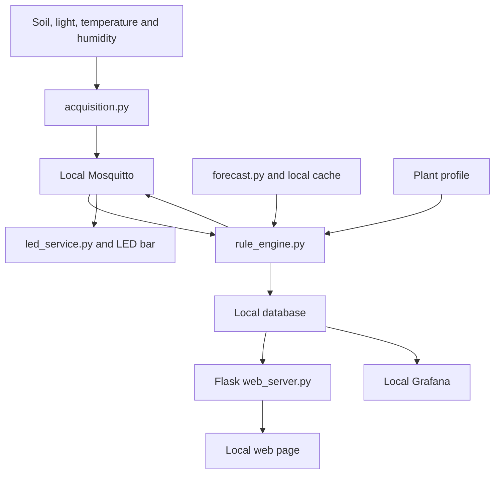

# PlantPulse · challenge-scope MVP

One plant and one Raspberry Pi 5: soil moisture, light, air temperature and humidity; local MQTT, storage, rules, LED feedback, Flask REST API, local web history and Grafana. Forecasts are the only Internet-dependent component.

## Scope and backlog
The baseline is **7 user stories and 48 tasks** from Backlog (challenge scope). Tasks link to their story with `Part of #N`; Setup tasks are project work. Closed legacy issues are excluded from the active backlog.

- [US-01 LED signal tells pupils when to check the plant](https://github.com/asiercorral/IoT-final-project/issues/3) · Must
- [US-02 Short explanation of each recommendation](https://github.com/asiercorral/IoT-final-project/issues/8) · Must
- [US-03 Teacher views sensor history](https://github.com/asiercorral/IoT-final-project/issues/4) · Must
- [US-04 Recommendations consider rain and rain exposure](https://github.com/asiercorral/IoT-final-project/issues/9) · Must
- [US-05 Distinct fault signal](https://github.com/asiercorral/IoT-final-project/issues/11) · Must
- [US-06 Monitoring continues without Internet](https://github.com/asiercorral/IoT-final-project/issues/31) · Must
- [US-07 Warning about low light over several afternoons](https://github.com/asiercorral/IoT-final-project/issues/32) · Should

## Sprint plan
| Sprint | Working dates | Goal | Review / deadline |
|---|---|---|---|
| Sprint 1 | 5–16 Nov 2026 | Sensing, calibration, local readings, basic status, forecast spike | Review 1: 17 Nov, 5 min |
| Sprint 2 | 17 Nov–2 Dec 2026 | MQTT, storage, rules, LED, Flask API, web, Grafana, forecast | Review 2: 3 Dec, 5 min |
| Sprint 3 | 3–11 Dec 2026 | Faults, Internet loss, validation, protection, power, docs, release | v1.0 and ALUD: 11 Dec |

Sprints transition on review dates. Rehearse on 16 Nov and 2 Dec. Integrate on 30 Nov. Freeze features on 9 Dec. Final demo: week of 14 Dec, 15 min, every member presents.

## Working agreement
- Status: To do → In progress → Review → Done. Backlog holds only untriaged items.
- Priority: Must, except US-07, T-13 and T-42 which are Should.
- Exactly one assignee per issue; task ownership can be rebalanced by the team.
- Branch per issue; pull request with `Closes #N`; one reviewer before merge.
- All four members commit weekly from their own accounts. Pair work uses `Co-authored-by:`.
- A story is Done only when all its tasks are Done and its acceptance criteria are shown on the Pi.
- Keep secrets in ignored `.env`; commit only placeholder values in `.env.example`.

## Initial ownership
| Area | Assignee |
|---|---|
| Sensing and LED | @asiercorral |
| Messaging and storage | @Ibonerdoiza2004 |
| Rules and weather | @eliaszlr |
| Web and docs | @ayaaitkassi0-01 |

Product Owner and Scrum Master remain a team decision tracked in T-02. Device, demo plant, database, forecast provider and sync slots remain open decisions.

## Behaviour to preserve
Normal = two steady LED segments; Check = half bar; Attention = full bar; Fault = blinking bar. Read every 5 min. Missing or invalid sensors, or telemetry older than 10 min, produce Fault. Forecasts older than 6 h are outdated. Rain can delay advice only if the plant is exposed and soil is not critically dry. Temperature and humidity are context. Persistent low light means three afternoons; night is ignored.

## Out of scope
Pump or automatic watering, phone alerts, weekly report endpoint, care button, PIR or voice calls, BLE, visits tracking, city map/dashboard, LoRaWAN, solar/battery nodes, multiple gardens, growth tracking, UV sensing and cloud analytics.

## Sources
- [Backlog (challenge scope)](https://drive.google.com/file/d/132IHZQTUt1mHTtIUlpEJLhnseDWigi8o/view)
- [Project plan](https://drive.google.com/file/d/1OE76R1GGBCSVXh0cgwe8XrwoHGQM-PIs/view)

## Planned architecture



The repository is at the planning stage. The programs below are planned deliverables tracked by the backlog, not claims of implemented or tested functionality.

## Interfaces

| Interface | Purpose |
|---|---|
| `plantpulse/school01/plant01/telemetry` | Non-retained timestamped sensor JSON |
| `plantpulse/school01/plant01/state` | Retained state, status code, reason and forecast used |
| `plantpulse/school01/plant01/status` | Retained online/offline state, with MQTT last will |
| `GET /api/status` | Current state, reason, readings, forecast and age |
| `GET /api/history?hours=24` | Timestamped history for the requested period |
| `GET /` | Local readings, history and care explanation |

Example telemetry from the plan:

```json
{
  "device_id": "plantpulse-school01-plant01",
  "timestamp": 1728920000,
  "sensors": {
    "temperature_c": 19.5,
    "humidity_pct": 78.0,
    "soil_moisture_raw": 420,
    "light_pct": 63.5
  },
  "status_code": "CHECK_MOISTURE"
}
```

Unavailable readings are JSON `null`. Add calibrated `soil_moisture_pct` after calibration; light is a relative percentage, not an uncalibrated claim of lux.

## Open decisions and validation

- Product Owner and Scrum Master: T-02 (#56).
- Grove modules, ports and Pi 5 drivers: T-05 (#7).
- Demo plant and substrate: T-06 (#33).
- Forecast provider: Euskalmet spike T-17 (#34), then document the fallback if needed.
- SQLite or InfluxDB: T-21 (#50).
- Full-chain validation: T-43 (#38).
- Rebuild instructions and wiring evidence: T-47 (#64).

No test results are claimed by this planning update. Hardware, integration and offline behaviour must be demonstrated before their issues are closed.
